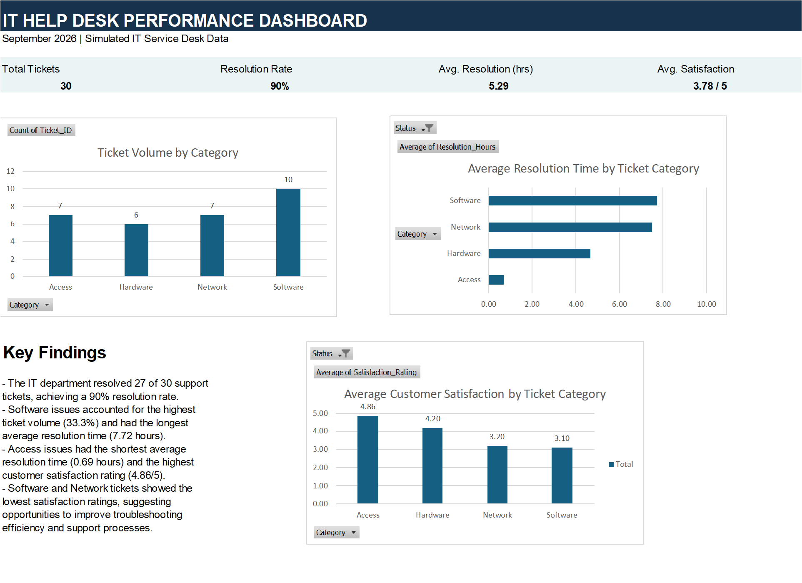

# IT Help Desk Ticket Analysis

### Excel Data Analytics Portfolio Project

## Project Overview

This project analyzes 30 simulated IT Help Desk support tickets from September 2026 to evaluate service desk performance, identify recurring technical issues, and recommend opportunities for operational improvement.

Using Microsoft Excel, I cleaned and analyzed ticket data, created Pivot Tables and charts, and developed an interactive-ready KPI dashboard to communicate key findings.

## Tools & Skills

- Microsoft Excel
- Data Cleaning and Validation
- Pivot Tables and Pivot Charts
- KPI Reporting
- Data Visualization
- Business Analysis and Recommendations

## Dataset

The dataset contains 30 fictional IT support tickets across four categories: Access, Hardware, Network, and Software.

Three tickets remained open, so their resolution times and satisfaction ratings were unavailable. These values were intentionally left blank to maintain data accuracy.

All 30 tickets were included in ticket-volume analysis. Resolution time and customer satisfaction were evaluated using the 27 resolved tickets.

## Key Performance Indicators

| KPI | Result |
|---|---|
| Total Tickets | 30 |
| Resolved Tickets | 27 |
| Open Tickets | 3 |
| Resolution Rate | 90% |
| Average Resolution Time | 5.29 hours |
| Average Customer Satisfaction | 3.78 / 5 |

## Dashboard

## Key Findings

**1. Software generated the highest ticket volume.**

Software accounted for 10 of 30 support tickets (33.3%), making it the most frequently reported issue category.

**2. Software and Network required the longest resolution times.**

Software tickets averaged 7.72 hours to resolve, while Network tickets averaged 7.50 hours. Access tickets had the shortest average resolution time at 0.69 hours.

**3. Customer satisfaction was lowest for Software and Network.**

Access had the highest average satisfaction rating at 4.86/5, followed by Hardware at 4.20/5. Network averaged 3.20/5, and Software had the lowest rating at 3.10/5.

## Business Recommendations

- Review recurring Software issues and improve troubleshooting documentation.
- Investigate Network-related delays and opportunities to streamline support processes.
- Improve communication and follow-up procedures for complex technical issues.
- Monitor resolution time and satisfaction trends to measure future improvements.

## Project Deliverables

- Excel workbook containing the original dataset, KPI calculations, Pivot Tables, charts, and dashboard.
- Dashboard screenshot for quick review.
- Written business insights and recommendations.

## About the Data

This project uses fictional data created for educational and portfolio purposes. No real customer, employer, or confidential information is included.
